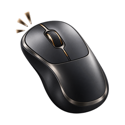
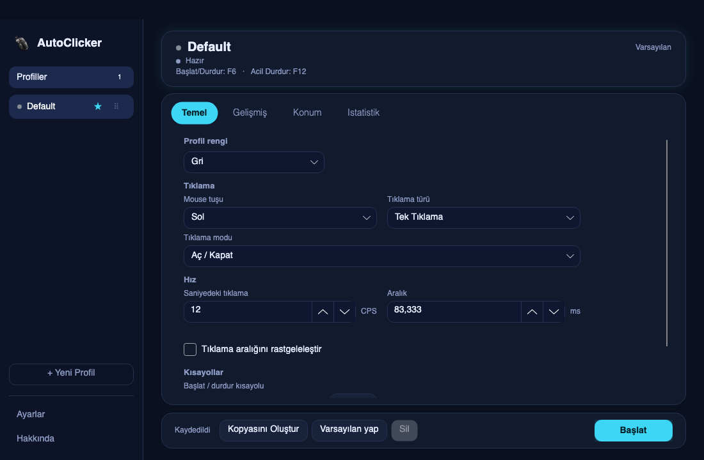
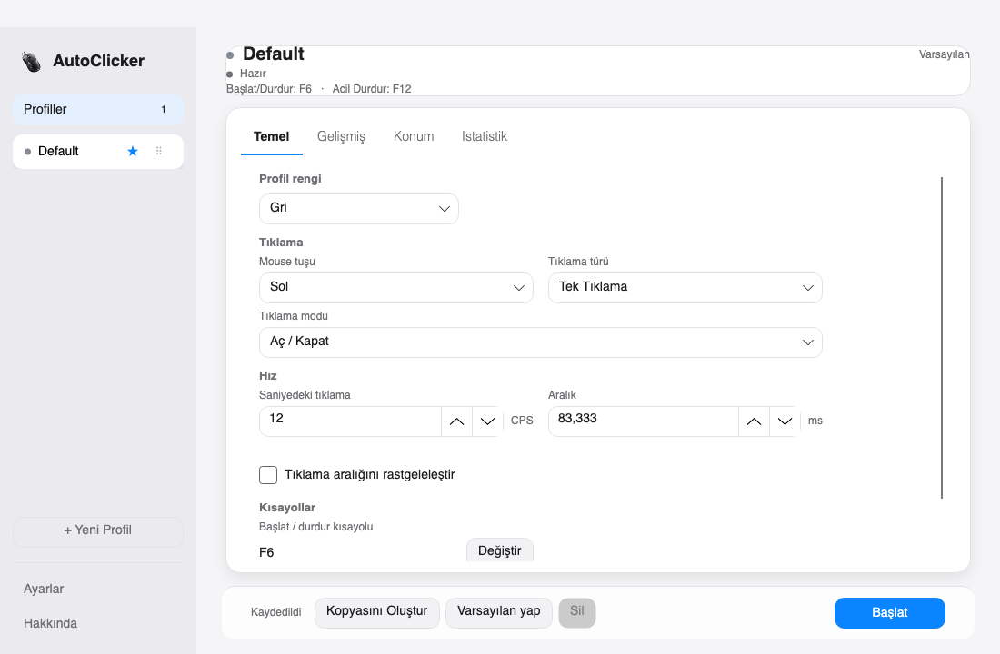
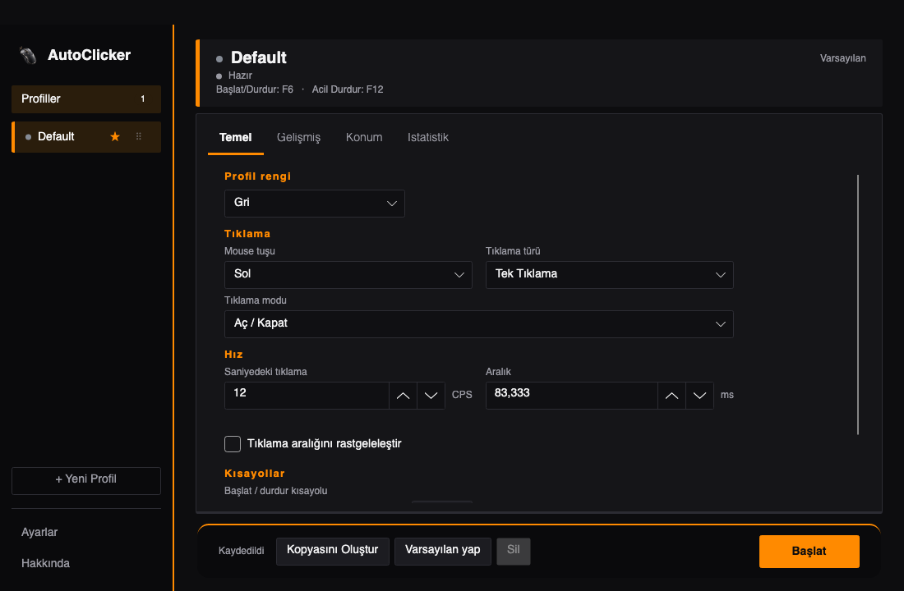
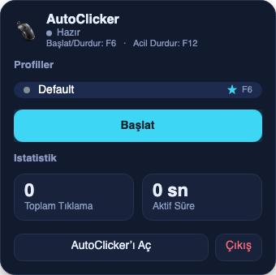

<div align="center">

[Türkçe](README.md) · **English**



# AutoClicker

**You wait. It clicks.**
A lightweight auto clicker with per-profile settings and speeds up to 500 clicks per second.

[](https://github.com/mertpural/auto-clicker/releases/latest)


[](LICENSE)

[**⬇️ Download (macOS)**](https://github.com/mertpural/auto-clicker/releases/latest/download/AutoClicker-1.0.0-macOS-arm64.dmg) · [**⬇️ Download (Windows)**](https://github.com/mertpural/auto-clicker/releases/latest/download/AutoClicker-1.0.0-win-x64-portable.zip) · [Website](https://autoclicker-tr.netlify.app) · [Report an issue](https://github.com/mertpural/auto-clicker/issues)

</div>

<p align="center">
  
  
  
</p>
<p align="center"><sub>Gece Neon, Sade Beyaz and Oyun HUD. There are 5 new themes plus the classic colors, all selectable in Settings.</sub></p>

## What does it do?

| | |
|---|---|
| 👤 **Profiles** | Save separate settings per game or task: speed, button, hotkey. Drag to reorder and pick a default. Ready-made suggestions for Minecraft and Roblox. |
| ⚡ **Up to 500 CPS** | From 0.001 to 500 clicks per second. Fixed or randomized interval; CPS and ms stay in sync. |
| 🖱️ **Click types** | Left, right and middle button. Single or double click. Toggle or hold mode. |
| 📊 **Statistics** | Total clicks and active time are tracked per profile. |
| ⌨️ **Hotkeys** | Start/stop (default F6) and emergency stop (F12). They work while the app is in the background. |
| 🍎 **Menu bar** | On Mac, click the menu bar icon for profiles, start/stop and statistics. It keeps running after you close the window. |
| 🎨 **Themes** | Gece Neon, Sade Beyaz, Aurora Cam, Terminal, Oyun HUD and the classic colors. Turkish and English interface. |
| 🔒 **Private** | No account, no server, nothing leaves your computer. Free and ad-free. |

<p align="center"></p>

## Install

### Mac (macOS 11 or later, Apple Silicon)

1. [Download the DMG](https://github.com/mertpural/auto-clicker/releases/latest/download/AutoClicker-1.0.0-macOS-arm64.dmg), open it and drag `AutoClicker` into **Applications**.
2. On first launch, **right-click → Open → Open** (needed because it has no commercial certificate).
3. In **System Settings → Privacy & Security**, grant **Accessibility** and **Input Monitoring**. The app tells you on screen if a permission is missing.

One line from Terminal:

```bash
curl -L https://github.com/mertpural/auto-clicker/releases/latest/download/AutoClicker-1.0.0-macOS-arm64.dmg -o /tmp/AutoClicker.dmg \
  && hdiutil attach -quiet /tmp/AutoClicker.dmg \
  && cp -R /Volumes/AutoClicker/AutoClicker.app /Applications/ \
  && hdiutil detach -quiet /Volumes/AutoClicker \
  && open /Applications/AutoClicker.app
```

### Windows (10 / 11, 64-bit)

[Download the ZIP](https://github.com/mertpural/auto-clicker/releases/latest/download/AutoClicker-1.0.0-win-x64-portable.zip), extract it to a folder and double-click **AutoClicker-Baslat.bat**. No installation needed. If Windows SmartScreen warns you, choose *More info → Run anyway*.

### Build from source

Requires the .NET 8 SDK.

```bash
git clone https://github.com/mertpural/auto-clicker.git
cd auto-clicker
dotnet run --project AutoClicker.csproj     # run
dotnet test AutoClicker.sln                 # tests
bash scripts/publish-macos.sh               # macOS DMG
```

## Notes

- Written in C#, .NET 8 and [Avalonia](https://avaloniaui.net); macOS and Windows share the same code.
- The Windows build was compiled and tested from a Mac and has not yet been widely tried on real Windows machines. If you hit a problem, please [report it](https://github.com/mertpural/auto-clicker/issues).
- Actual click speed may deviate from the target depending on system load.
- See [ROADMAP.md](ROADMAP.md) for what is planned and [CHANGELOG.md](CHANGELOG.md) for changes.

## License

MIT
