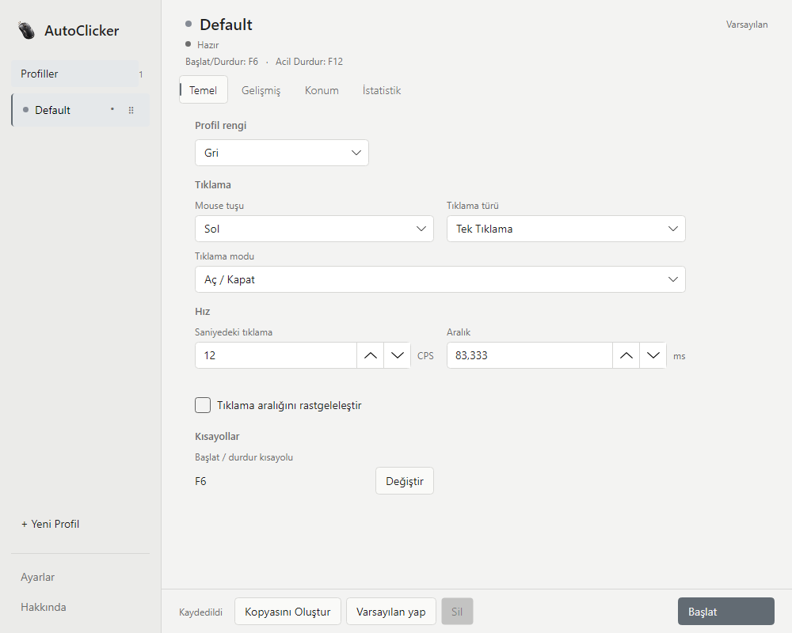
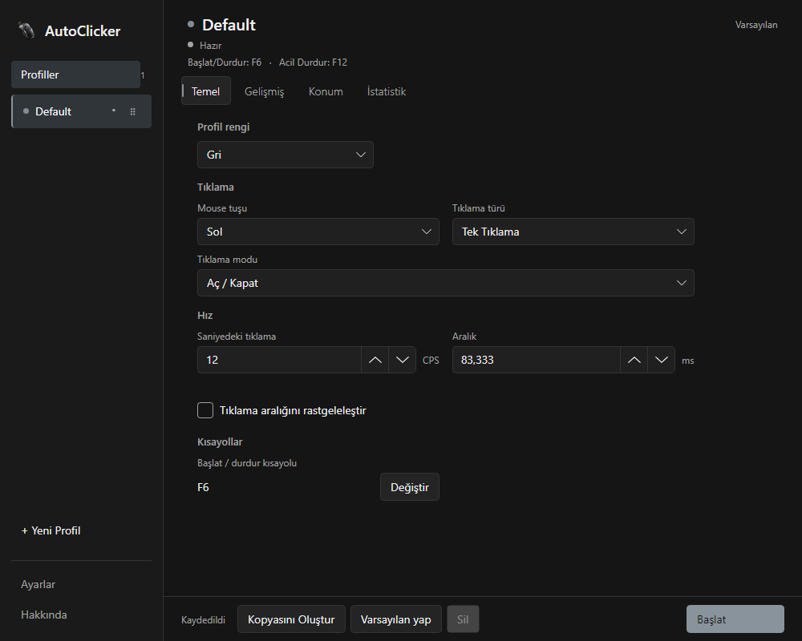
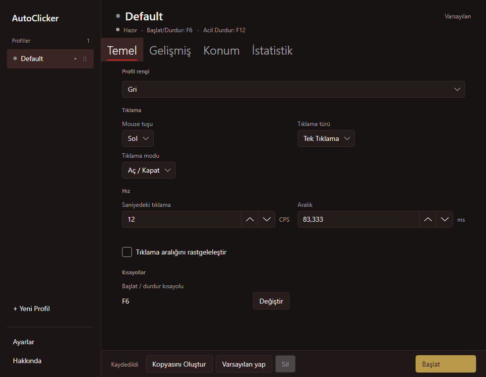
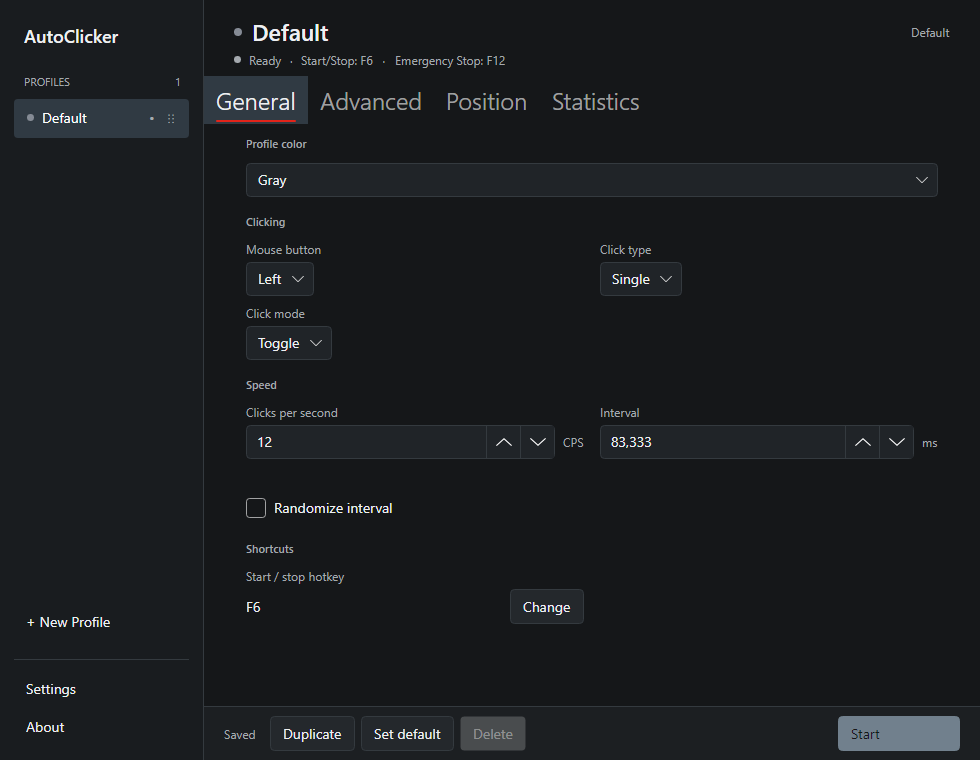
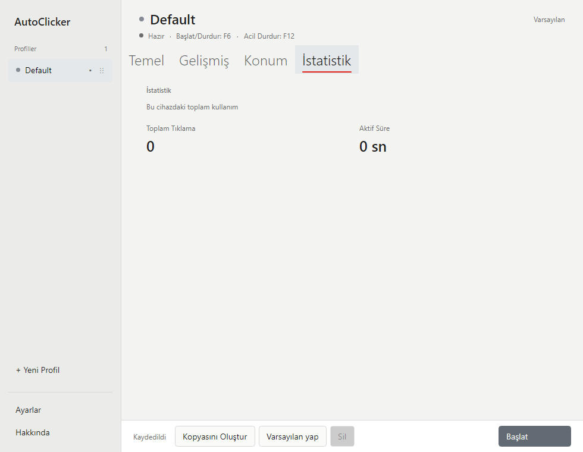
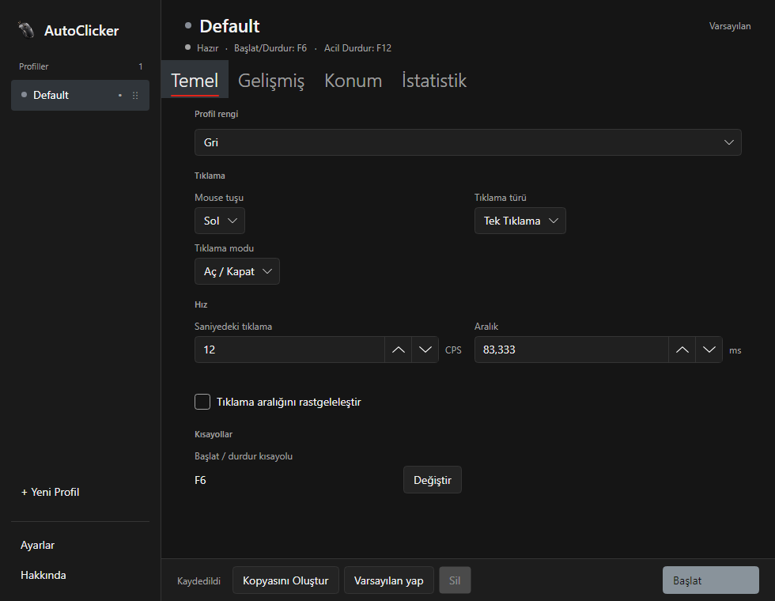
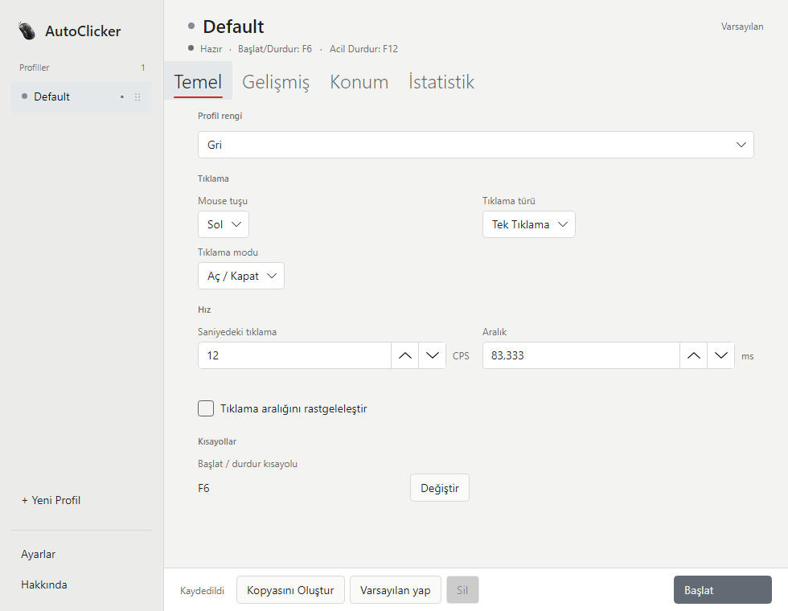
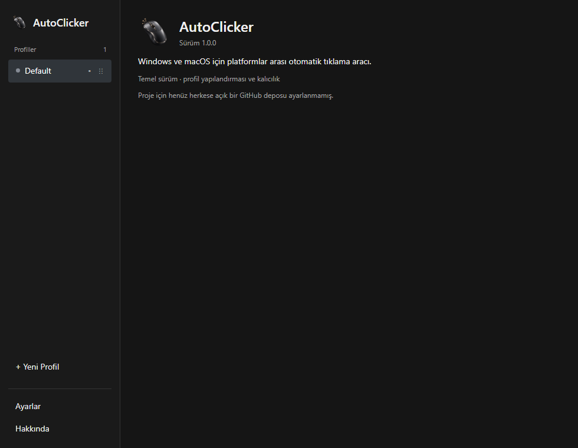

# AutoClicker

C#, .NET 8 ve Avalonia ile Windows / macOS için ortak kod tabanına sahip masaüstü AutoClicker projesi.

**Mevcut teslimat: 1.0.0 Windows portable sürüm adayı.** Dil, gezinme, sürükleme ve lifecycle düzeltmeleri gerçek Avalonia kontrolleriyle doğrulandı. Ayrıntılı sonuçlar ve ölçüm sınırları [son doğrulama raporunda](docs/FINAL_OWNER_AUDIT.md) bulunur. Sürüm `Directory.Build.props` içinde `1.0.0`, macOS bundle kimliği aynı dosyadaki `ApplicationBundleIdentifier` değeridir: `com.mertpural.autoclicker`. macOS izinleri mouse control için Accessibility, global input gözlemi için Input Monitoring kullanır.

## Features

Tamamlanan özellikler:

- Beş projeli solution, MVVM, compiled bindings ve dependency injection.
- İlk açılışta otomatik `Default` profil oluşturma.
- Profil oluşturma, ad değiştirme, kopyalama, silme ve varsayılan profil seçme.
- Son seçilen profili hatırlama ve silme öncesi onay.
- Mouse button, click type, click mode, CPS, interval ve randomization ayarlarını düzenleme.
- İki yönlü CPS / interval senkronizasyonu; desteklenen profil hız aralığı 0.001–500 CPS. Windows'taki gerçek `SendInput` ölçümünde 1000 CPS hedefi 700–800 CPS üretirken 500 CPS'e kadar sonuç hedefe yakındı; bu nedenle ürün sınırı 500 CPS'tir. İşletim sistemi yükü gerçek hızı yine etkileyebilir.
- Double precision random interval hesaplaması ve alan doğrulama.
- Start delay, fiziksel click limiti, süre limiti ve burst ayarları; eski JSON profilleri varsayılanlarla açılmaya devam eder.
- İptal edilebilir Core click engine: absolute monotonic cycle deadlines, fixed / random CPS, double-click sayımı, limitler, burst beklemesi, en fazla saniyede 10 UI telemetry güncellemesi ve yapılandırılmış hata bildirimi. Windows kısa beklemelerde per-wait high-resolution waitable timer kullanır; macOS TimeProvider tabanlı platform timer'ını korur.
- Windows `SendInput` tabanlı sol / sağ / orta mouse click; down ve up olayları tek çağrıda gönderilir, sabit konum varsa click öncesi cursor taşınır.
- Windows `GetCursorPos` / `SetCursorPos`; ekranın solundaki ikincil monitörler için negatif sanal ekran koordinatları desteklenir.
- Profil düzenleyicisinde Current cursor / Fixed screen position seçimi, sabit X/Y alanları ve ekranın herhangi bir noktasını tıklayarak koordinat seçme.
- Windows `WH_KEYBOARD_LL` ve `WH_MOUSE_LL` dinleyicileri: global Toggle / Hold shortcuts, Mouse Hold tetikleyicisi ve varsayılan `F12` emergency stop. AutoClicker'ın `SendInput` olayları app-specific `dwExtraInfo` etiketi taşır.
- Kısayol kaydı sırasında profil aksiyonları askıya alınır; acil durdurma etkin kalır. Kısayol yeniden ataması başarısız olursa önceki atama korunur.
- macOS `CGEventCreateMouseEvent` / `CGEventPost` ile sol, sağ ve orta click; Quartz global ekran koordinatlarında mevcut cursor veya sabit pozisyon desteği.
- macOS listen-only CoreGraphics event tap ile Toggle / Hold shortcuts, Mouse Hold ve `F12` Emergency Stop. AutoClicker'ın Quartz olayları `kCGEventSourceUserData` alanında app-specific işaret taşır; dinleyici olayları bastırmaz.
- macOS Accessibility ve Input Monitoring izinleri ayrı kontrol edilir; uygulama başlangıcında prompt gösterilmez, Settings ekranından istek, System Settings açma ve Retry yapılabilir.
- 500 ms debounce ile otomatik kaydetme; çıkışta bekleyen değişiklikleri flush etme.
- Versioned JSON, atomik dosya değiştirme, eşzamanlı yazma koruması ve dosya boyutu sınırı.
- Bozuk dosyayı koruyan hata ekranı; yükleme başarısızsa düzenleme/yazma engellenir.
- Profil düzenleyicisi General, Advanced, Position ve Statistics sekmelerine ayrılır; son seçilen sekme profiller arasında korunur.
- System, Night, Crimson Gold, Graphite ve Light temaları semantic kaynaklardan beslenir; Settings'ten anında değişir ve seçim saklanır.
- Profil başlığında yerelleştirilmiş çalışma durumu ve ilgili kısayollar gösterilir; temel ve gelişmiş profil kontrollerinde kısa, iki dilli tooltip'ler bulunur.
- Settings görünümü General, Appearance, Shortcuts, Permissions ve Data gruplarına ayrılır; tema seçeneklerinde küçük palet önizlemeleri vardır.
- Final mouse artwork Windows executable/window/tray, About/sidebar, Inno Setup ve macOS app bundle ikonlarına bağlanır; master kaynak ve tekrar üretilebilir platforma uygun ikon betikleri `assets/branding/` ve `scripts/` altındadır.
- Türkçe varsayılan arayüz ve English dil seçeneği; dil seçimi yerel ayarlarda saklanır ve uygulama yeniden başlatılmadan değiştirilebilir.
- Application data altında structured JSON log dosyaları.
- Kalıcı yerel kullanım istatistikleri: tüm profiller için Total Clicks ve Total Active Time; yalnızca başarılı fiziksel click'ler ve motorun Running süresi sayılır. Değerler uygulama açılışları arasında saklanır ve Settings → Data ekranından sıfırlanabilir. Hiçbir yere gönderilmez.
- Windows system tray ve macOS menu bar için Avalonia tray icon/native menu; durum, profil, Start / Stop, Open ve Quit eylemleri.
- macOS menü çubuğu simgesi gerçek bir `NSStatusItem` ile oluşturulur (Avalonia macOS'ta tray tıklama olayı sunmaz); tıklayınca profil listesi, Start / Stop, toplam tıklama/aktif süre ve Open / Quit içeren pop-up açılır. Simge oluşturulamazsa Avalonia tray menüsüne dönülür.
- Temalar: Gece Neon (varsayılan), Sade Beyaz, Aurora Cam, Terminal, Oyun HUD tasarım temaları ile System, Night, Crimson Gold, Graphite, Light renk temaları. Tasarım temaları `src/AutoClicker.App/Designs/` altındaki stil dosyalarını çalışma anında yükler.
- Profil sidebar'ında inline rename (Enter / focus kaybı ile kaydetme, Escape ile iptal), case-insensitive duplicate-name kontrolü, sürükle-bırak ve taşıma komutları; profil sırası ve Gray–Pink aralığındaki muted renk paleti ayarlarla saklanır.
- Close-to-tray, start minimized, launch on startup ve existing-window activation ile single-instance çalıştırma.
- Core, MVVM, Windows ve macOS input eşlemesini kapsayan testler; tüm native input testleri sahte API kullanır ve gerçek click göndermez.

Phases:

- Phase 1–2: Foundation — complete.
- Phase 3: Click engine — complete.
- Phase 4: Windows native input — complete.
- Phase 5: macOS native input — implemented; real macOS desktop verification remains.
- Phase 6: Desktop polish — implemented; real tray/startup integration still needs platform desktop verification.
- Phase 7: Distribution — Windows / macOS release packaging configuration implemented; native artifact production depends on host OS and tools.

Profile JSON import/export and bulk profile reset controls remain future work.

### Profil rename, sıralama ve renk için manuel smoke test

Bu kontroller Windows ve macOS masaüstü build'lerinde uygulanabilir. Otomatik testler gerçek Avalonia kontrollerini, view-model, tray label ve JSON persistence akışlarını kapsar; gerçek pencerede bu adımlar henüz manuel doğrulanmadı.

1. Sidebar'da bir profilin menüsünden **Rename** seçin; metnin seçili geldiğini ve odak aldığını doğrulayın.
2. Yeni bir ad yazıp Enter'a basın; sidebar, workspace başlığı ve tray/menu bar profil adının anında güncellendiğini kontrol edin.
3. Başka bir ad yazıp boş alana tıklayın; değişikliğin kaydedildiğini doğrulayın. Ardından rename'i Escape ile iptal edip eski adın korunduğunu kontrol edin.
4. Boş, yalnızca boşluklardan oluşan ve başka bir profilin büyük/küçük harf farkı dışında aynı olan adları deneyin; hata gösterilmeli ve kayıtlı ad değişmemelidir.
5. Rename açıkken başka bir profile **Move Up** veya **Move to Top** uygulayın; taslak aynı profil kimliğinde kalmalı. Enter ile kaydedip sıralamayı doğrulayın.
6. Bir profili handle'ından yukarı ve aşağı sürükleyin; hedef göstergesini, seçili profilin korunmasını ve motorun durumunun değişmemesini doğrulayın.
7. İlk ve son profil menülerinde sırasıyla **Move Up** ve **Move Down** komutlarının devre dışı olduğunu kontrol edin. Move Up, Move Down, Move to Top ve Move to Bottom komutlarını deneyin.
8. Default profil dahil profilleri taşıyın; default işaretinin değişmediğini ve yeni profilin listenin sonuna eklendiğini doğrulayın.
9. Bir profile paletten renk verin; sidebar'daki küçük noktanın güncellendiğini, renk listesinin minimal kaldığını ve tray görünümünün desteklediği profil etiketlerinin güncel olduğunu kontrol edin.
10. Uygulamayı normal kapatıp yeniden açın; adları, sıralamayı, renkleri, seçili profili ve default profili doğrulayın. Aynı adımları Windows tray ve macOS menu bar üzerinde tekrarlayın.

### Dil seçimi için manuel smoke test

1. Boş bir data diziniyle ilk açılışı yapın; işletim sistemi dili İngilizce olsa da arayüz Türkçe başlamalıdır.
2. Ayarlar → Dil alanından English seçin; açık sayfa, profil açılır listeleri, istatistikler ve tray/menu bar metinleri anında İngilizceye dönmelidir.
3. Yeniden Türkçe seçin; profil adı düzenlemesi açıksa taslak korunmalı, çalışan motor durmamalı ve basılı mouse tuşu bırakılmamalıdır.
4. Uygulamayı kapatıp açın; son seçilen dilin korunduğunu doğrulayın. `settings.json` dosyasında dil tercihi `Turkish` veya `English` olarak saklanır.

## Timing and development diagnostics

The click loop schedules against absolute monotonic deadlines. If a cycle finishes late, expired slots are skipped; the engine does not emit catch-up bursts. Windows uses a cancellable per-wait high-resolution waitable timer where available and falls back to a standard waitable timer on older Windows releases. macOS uses the portable `TimeProvider` delay. Actual throughput still depends on OS scheduling and native input behavior; configured CPS is not a hardware guarantee.

Measure scheduler throughput without generating mouse input:

```powershell
dotnet run --project tools/AutoClicker.TimingDiagnostic -- --seconds=2
```

The diagnostic uses a fake mouse sink and measures 10, 25, 50, 100, 200, and 500 CPS targets. To measure only selected targets for longer, pass for example `--targets=50,100,200 --seconds=5`. It reports observed scheduler CPS, process CPU time, and Windows timer waits/handle creation; it never calls native mouse input. `--diagnostics` on the application enables five-second process samples in the local application log: managed heap, working set, private bytes, thread count, GC collections, and engine state. No measurements are collected during normal startup.

## Screenshots

Gerçek Avalonia penceresinin istemci alanından Windows üzerinde üretilmiştir.
Güncel on görüntü `docs/screenshots/owner-audit/`, dört boyuttaki Türkçe/İngilizce kontrolleri `docs/screenshots/owner-audit/responsive/` altındadır. Aşağıdaki eski aşama önizlemeleri geliştirme geçmişidir; güncel teslimat görüntüleri owner-audit klasöründedir.

Görüntüleri yeniden üretmek için Release derlemesinden sonra:

```powershell
.\scripts\capture-owner-qa.ps1
.\scripts\capture-responsive-qa.ps1
```

Yayımlanan EXE de bu betiklere `-Application artifacts/publish/win-x64/AutoClicker.exe` ile verilebilir. Kontrol otomasyonu ve iki turlu süreç ölçümü:

```powershell
dotnet bin/Release/net8.0/AutoClicker.dll --smoke-test --smoke-tray --data-dir=artifacts/qa-controls --control-smoke-report=artifacts/qa-controls.json
dotnet bin/Release/net8.0/AutoClicker.dll --smoke-test --smoke-tray --data-dir=artifacts/qa-retention --retention-report=artifacts/qa-retention.json
```

Bu açıkça seçilen smoke akışları gerçek Avalonia penceresini kullanır; mouse output sahte adaptördür ve normal kullanıcı yapılandırması ayrıdır. Kontrol smoke'u düğme automation peer'ları, routed pointer olayları ve gerçek ComboBox binding'lerini denetler. Bunlar insan tarafından yapılan OS mouse/hotkey/drag testi değildir. Retention akışı diagnostics UI açmaz, GC zorlamaz ve iki turun sonunda ölçüm JSON'unu yazar.

### Light



### Dark



## Requirements

- Windows veya macOS.
- .NET 8 SDK veya .NET 8 hedefini derleyebilen daha yeni bir SDK.
- Geliştirme sırasında framework-dependent çalıştırma için .NET 8 runtime.
- İlk restore için NuGet erişimi.

Projelerin tamamı `net8.0` hedefler. Bu çalışma Windows üzerinde .NET 10 SDK ve .NET 8 runtime ile derlenip test edilmiştir. macOS native input gerçek bir macOS masaüstünde henüz manuel doğrulanmamıştır.

## Build

Repository kökünde:

```bash
dotnet restore
dotnet build
dotnet run
dotnet test
```

`AutoClicker.csproj` masaüstü App projesidir; solution içindeki adı `AutoClicker.App` olarak görünür. App kaynakları `src/AutoClicker.App` altında tutulur. Proje dosyası solution ile aynı adı taşıdığı için kök dizindeki yalın `dotnet` komutları dosya seçimi hatası vermez; `dotnet run` tek executable projeyi seçer.

Release doğrulaması:

```bash
dotnet build AutoClicker.sln -c Release
dotnet test AutoClicker.sln -c Release
dotnet publish AutoClicker.csproj -c Release -r win-x64 --self-contained true -o artifacts/publish/win-x64
dotnet publish AutoClicker.csproj -c Release -r osx-arm64 --self-contained true -o artifacts/publish/osx-arm64
```

`Directory.Build.props` tek sürüm kaynağıdır. `scripts/publish-windows.ps1` ve `scripts/publish-macos.sh` testleri varsayılan olarak çalıştırır. Windows ZIP/installer ve macOS `.app`/DMG dosyaları yalnızca `artifacts/` içine yazılır. Canonical kaynak `assets/branding/autoclicker-icon-source.png`, 1024px master ise `assets/branding/autoclicker-icon-1024.png` dosyasıdır. Windows ICO, Windows PowerShell ve yerleşik `System.Drawing` ile `powershell -ExecutionPolicy Bypass -File scripts/generate-icons.ps1` komutuyla üretilir; macOS ICNS türevleri macOS'ta yerleşik `sips` ve `iconutil` kullanan `bash scripts/generate-macos-icons.sh` ile üretilir. Release script'leri ilgili üretimi otomatik çalıştırır. Pillow, ImageMagick veya uygulama runtime'ında ek dependency gerekmez.

Engine `Starting` durumunda başlangıç gecikmesini sayar; `Running` süresi gecikme tamamlandıktan sonra başlar. Click limitleri fiziksel mouse click sayar; double click iki click çağrısıdır ve tek kalan limitte bir click üretilir. CPS, mantıksal cycle hızıdır. Burst boyutu cycle sayar ve her normal cycle aralığının ardından ek burst beklemesi gelir. Random CPS telemetry'si seçilen aralığı ve son planlanan hızı bildirir; sabit hedef random modda boş bırakılır. Durdurma, limit tamamlanması, süre dolması ve mouse hatası telemetry'de ayrı nedenlerle raporlanır.

### Windows

Konfigürasyon:

```text
%LOCALAPPDATA%\AutoClicker\settings.json
%LOCALAPPDATA%\AutoClicker\logs\application.jsonl
```

Self-contained publish örneği; hedef makinada ayrıca .NET runtime gerekmez:

```bash
dotnet publish AutoClicker.csproj -c Release -r win-x64 --self-contained true -o artifacts/publish/win-x64
dotnet publish AutoClicker.csproj -c Release -r win-arm64 --self-contained true -o artifacts/publish/win-arm64
```

Release script'i Windows x64 self-contained publish, smoke test, portable ZIP, SHA-256 ve Inno Setup varsa installer üretir:

```powershell
.\scripts\publish-windows.ps1
.\scripts\publish-windows.ps1 -IncludeArm64
```

Bu QA teslimatında Windows x64 self-contained portable ZIP üretildi: `artifacts/release/windows/AutoClicker-1.0.0-win-x64-portable.zip`. SHA-256 yan dosyası ve `release-manifest.json` aynı klasördedir. Inno Setup bu makinede kurulu olmadığından setup EXE üretilmedi. Portable kullanımda ZIP'i açıp `AutoClicker\AutoClicker.exe` çalıştırın; klasör startup etkinleştirildikten sonra taşınırsa başlangıç kaydı eski yolu tutabilir. Inno Setup ile kurulum üretildiğinde per-user hedef `%LOCALAPPDATA%\Programs\AutoClicker` olur. Tanımlı upgrade kullanıcı ayar/profillerini korur; kaldırma uygulama dosyalarını, shortcut'ları ve yalnızca AutoClicker'ın HKCU Run kaydını kaldırır. Profil ve logları silmez. App normal kullanıcı olarak çalışır, kernel driver kurmaz ve standart Windows `SendInput` kullanır. Yüksek yetkili hedefler veya bazı oyunlar sentetik input'u reddedebilir.

Windows x64 ana release mimarisidir; win-arm64 isteğe bağlıdır. macOS arm64 ana mimaridir; osx-x64 isteğe bağlıdır. Self-contained release hedef bilgisayarda .NET runtime gerektirmez. Installer için Inno Setup 6 kurulu olmalıdır. Windows ve macOS için ayrıntılı manuel release kontrol listesi [docs/RELEASE_QA_CHECKLIST.md](docs/RELEASE_QA_CHECKLIST.md) içindedir. Düşük CPS kullanın.

### macOS

Konfigürasyon:

```text
~/Library/Application Support/AutoClicker/settings.json
~/Library/Application Support/AutoClicker/logs/application.jsonl
```

Release script'i arm64 self-contained publish, `.app`, DMG, SHA-256 ve isteğe bağlı imza/notarization yapar. macOS host gereklidir:

```bash
bash scripts/publish-macos.sh
bash scripts/publish-macos.sh --include-x64
```

DMG'yi açın, `AutoClicker.app` uygulamasını `/Applications` veya `~/Applications` içine sürükleyin ve başlatın.

Mac için notlar:
- Projeyi iCloud ile senkronlanan `Documents` klasöründe derlerseniz `codesign` "resource fork, Finder information, or similar detritus not allowed" hatası verebilir. Betik paketi geçici bir klasörde derleyip imzaladığı için bu sorun oluşmaz; `.app` yerine DMG dağıtım dosyası üretilir.
- Ad-hoc (ücretsiz) imza kullanıldığında her yeni derleme macOS için farklı bir uygulama olduğundan Accessibility / Input Monitoring izinleri yeniden verilmelidir. Bu tekrarı önlemek için sabit bir imza kimliği gerekir; kimlik `APPLE_SIGNING_IDENTITY` ortam değişkeniyle betiğe verilebilir. Ücretsiz yerel sertifika oluşturmak anahtar zincirinde kalıcı bir değişiklik olduğundan kullanıcı onayı ile yapılmalıdır.
- Oturum açılışı için LaunchAgent, uygulamanın `/Applications` altındaki yolunu kullanır; uygulamayı taşıdıysanız Ayarlar'da başlangıç seçeneğini kapatıp yeniden açın. İzin gerekince Accessibility (mouse control) ve Input Monitoring (global input/hotkeys) verin, AutoClicker'a dönüp Retry seçin. `Directory.Build.props` bundle ID ve executable adı TCC kimliği açısından release'ler arasında sabit kalmalıdır. `dotnet run` geliştirme süreci final `.app`'ten ayrı bir izin girdisi gösterebilir. Startup `.app`'i `/usr/bin/open` üzerinden başlatır; `.app` taşınırsa startup ayarını kapatıp yeniden açarak yolu güncelleyin.

Minimum macOS sürümü ayrıca sabitlenmedi ve bu değişiklikte gerçek Mac üzerinde doğrulanmadı; .NET 8/Avalonia gereksinimleri ve hedef Mac testleriyle belirlenmelidir. Accessibility ve Input Monitoring izinleri kamera/mikrofon kullanım açıklaması değildir; sahte plist privacy key eklenmedi. İmzasız yerel build Gatekeeper uyarısı verebilir; Gatekeeper/SIP'i kapatmayın.

İmza için `APPLE_SIGNING_IDENTITY` verildiğinde Hardened Runtime ile codesign yapılır; entitlement eklenmedi çünkü mevcut uygulama akışı için gerekliliği doğrulanmadı. Notarization `APPLE_NOTARY_PROFILE` veya `APPLE_ID`, `APPLE_TEAM_ID`, `APPLE_APP_PASSWORD` ile isteğe bağlıdır. Unsigned, signed Developer ID ve signed+notarized build'ler farklı dağıtım durumlarıdır. Sertifikalar ve credentials repoya konmaz; unit testler imza/keychain/Apple sunucularına erişmez.

Gerçek Mac son kontrolü: DMG mount, Applications'a taşıma, açılış, izin UI ve Retry, Toggle/Hold/Mouse Hold/F12, Pick Position, menu bar, startup, single-instance, kapatma/minimize ve reboot/login sonrası çalıştırma. Signed build'de codesign; notarized build'de başka Mac'te Gatekeeper kontrolü. Self-contained app ayrıca .NET gerektirmez.

macOS platform yetenek matrisi:

- Mouse control: Accessibility ve Post Event Access izni gerekir.
- Global Toggle / Hold / Emergency Stop: Input Monitoring izni ve listen-only event tap gerekir.
- Input Monitoring yoksa UI Start kullanılabilir; global shortcuts kullanılamaz.
- Mouse izni yoksa Start kapalı kalır ve Settings ekranı izin durumu ile Open System Settings / Retry / Request permission kontrollerini gösterir.
- Event tap keyDown / keyUp / flagsChanged olaylarını gözler, olayları yutmaz veya değiştirmez.

Manuel macOS smoke test (gerçek macOS masaüstünde):

1. Uygulamayı açıp Settings → Request permission ile izin akışını başlatın; Accessibility ve Input Monitoring için AutoClicker'ı etkinleştirin.
2. Uygulamaya dönüp Retry seçin. Accessibility eksikse Start devre dışı kalmalı; Input Monitoring eksikse mouse Start kullanılabilirken global shortcut durumu kullanılamaz görünmelidir.
3. Güvenli ve kaydedilebilir bir hedef (ör. boş TextEdit belgesi) kullanarak düşük CPS ile Left / Right / Middle click deneyin; önce UI Start / Stop'u, sonra Toggle kısayolunu doğrulayın.
4. Hold modunda kısayolu basılı tutup bırakın; motor başlamalı ve chord'un herhangi bir gerekli modifier'ı bırakıldığında durmalıdır.
5. Engine çalışırken F12 Emergency Stop'u deneyin; start delay veya running durumunda motor durmalıdır.
6. Sabit konum profilinde negatif sanal ekran koordinatını veya bağlı ekran üzerindeki pozitif koordinatı elle girip deneyin. Cursor ve profil koordinatları CoreGraphics global display points kullanır; ekran yerleşimine bağlı olarak X/Y negatif olabilir. Retina için elle ×2 dönüşümü yapılmaz.
7. Uygulamayı normal şekilde kapatın; shortcut dinleyicisi kapanmalı ve arka planda event tap bırakmamalıdır.

## Permissions

macOS'ta mouse event gönderimi için **Privacy & Security → Accessibility** / Post Event Access; global klavye kısayolları için ayrıca **Privacy & Security → Input Monitoring** gerekir. İzinler ayrı kontrol edilir. Uygulama başlangıcında sürekli prompt göstermez; Settings içinden Request permission, Open System Settings ve Retry kullanılabilir. macOS TCC değişikliklerinin mevcut süreçte uygulanması sistem sürümüne bağlıdır; Retry sonrasında izin görünmüyorsa uygulamayı kapatıp yeniden açın.

Windows uygulama manifest'i `asInvoker` kullanır. Windows input erişimi yükseltilmiş hedef uygulamalarda garanti edilmez. Uygulama süreç enjeksiyonu, kernel driver, anti-cheat müdahalesi veya input bypass kullanmaz. Uygulamaya analytics veya auto-update eklenmemiştir.

## Architecture

```text
AutoClicker.sln
AutoClicker.csproj                     # AutoClicker.App executable
Directory.Build.props                 # net8.0, nullable, C# 12, warnings as errors
src/
  AutoClicker.App/
    Composition/                      # Service lifetime / platform selection
    Services/                         # Debounce, logging, dialogs, theme, UI dispatcher
    ViewModels/                       # Main, profile workspace, editor, settings
    Views/                            # Avalonia AXAML views
    App.axaml                         # Shared styles and theme resources
  AutoClicker.Core/
    Abstractions/                     # Engine, mouse, cursor, hotkeys, permission contracts
    Models/                           # Immutable profile and settings snapshots
    Persistence/                      # JSON codec and atomic application store
    Timing/                           # CPS / interval / randomization calculations
    Services/                         # Platform-independent AutoClickerEngine
    Validation/                       # Profile and document invariants
  AutoClicker.Platform.Windows/        # Windows adapter project
  AutoClicker.Platform.MacOS/          # Quartz mouse/cursor, event tap and permission adapter
tests/
  AutoClicker.Tests/                   # xUnit tests with fake platform / UI services
docs/screenshots/
```

Core, Avalonia'ya veya platform projelerine referans vermez. Her platform projesi yalnızca Core'a referans verir. App, composition root üzerinden doğru platformu seçer. `AutoClickerEngine` yalnızca Core'daki `IMouseService` sözleşmesini kullanır. Windows `SendInput` ve global hook adaptörleri `AutoClicker.Platform.Windows`; Quartz mouse, cursor, event tap ve permission adaptörleri `AutoClicker.Platform.MacOS` içindedir. Start, Windows native capability'siyle; macOS'ta ise ayrıca mouse permission state'iyle etkinleşir.

Editor, mutable UI alanlarını immutable profil snapshot'larına dönüştürür. Geçersiz alanlar persistence'a iletilmez. MainWindowViewModel navigasyon ve kapanışı; ProfilesViewModel profil işlemlerini; ProfileEditorViewModel alanları ve doğrulamayı yönetir. Disk yazımı UI koleksiyonlarını arka planda enumerate etmez.

### NuGet packages

- `Avalonia`, `Avalonia.Desktop`, `Avalonia.Themes.Fluent`: **11.3.22**.
- `CommunityToolkit.Mvvm`: **8.4.2**.
- `Microsoft.Extensions.DependencyInjection`, `Microsoft.Extensions.Logging`: **8.0.1**.
- `Microsoft.NET.Test.Sdk`: **17.14.1**.
- `xunit`: **2.9.3**.
- `xunit.runner.visualstudio`: **3.1.5**; test projesine private asset olarak eklenir.

JSON için .NET'in `System.Text.Json` kütüphanesi kullanılır; Core'ın harici NuGet bağımlılığı yoktur.

## Development

Temel masaüstü smoke testi; gerçek pencereyi açar, profil saklamayı doğrular ve kapanır. Mouse click üretmez:

```bash
dotnet run -- --smoke-test --data-dir=artifacts/smoke-test
```

`--data-dir=<path>` geliştirmede kalıcı veriyi izole etmeye yarar. Üretim veri klasörü belirtilmeyen normal çalıştırmada platforma uygun application data yolu kullanılır. Windows başlangıç kaydı kullanıcı `Run` anahtarını, macOS ise kullanıcı `LaunchAgents` kaydını kullanır. Windows mutex kimliği bundle ID + kullanıcı adından türetilir, executable yoluna bağlı değildir; macOS file lock ve aktivasyon kanalı sabit per-user application-data dizinindedir. Portable ve installed kopyalar aynı kullanıcıda aynı uygulama örneğine yönelir.

Arayüz smoke testi gerçek pencereyi açar, tema/dil/sekme seçimini uygular, ekran görüntüsü alır ve kapanır. Fare tıklaması üretmez; her çağrıda ayrı data klasörü kullanın:

```bash
dotnet run -- --smoke-test --data-dir=artifacts/ui-smoke/night --preview-theme=Night --preview-language=Turkish --screenshot=docs/screenshots/ui-redesign/turkish-night.png
dotnet run -- --smoke-test --data-dir=artifacts/ui-smoke/crimson --preview-theme=CrimsonGold --preview-language=Turkish --screenshot=docs/screenshots/ui-redesign/turkish-crimson-gold.png
dotnet run -- --smoke-test --data-dir=artifacts/ui-smoke/graphite --preview-theme=Graphite --preview-language=English --screenshot=docs/screenshots/ui-redesign/english-graphite.png
dotnet run -- --smoke-test --data-dir=artifacts/ui-smoke/light --preview-theme=Light --preview-tab=Statistics --preview-language=Turkish --screenshot=docs/screenshots/ui-redesign/turkish-light.png
```

Son komut `--preview-tab=General|Advanced|Position|Statistics` seçeneğiyle başka bir sekmeyi de yakalayabilir. Bu aşamada üretilen dört önizleme:






Final branding ile alınan masaüstü smoke görüntüleri ve About örneği `docs/screenshots/ui-branding/` altındadır. About görüntüsü `--preview-page=About` ile alınabilir; diğer görünüm parametreleri aynıdır:

```bash
dotnet run -- --smoke-test --data-dir=artifacts/branding-smoke/about --preview-theme=Night --preview-language=Turkish --preview-page=About --screenshot=docs/screenshots/ui-branding/turkish-night-about.png
```

Windows'ta native tray kaynağını kısa süreli başlatıp doğrulamak için `--smoke-tray` eklenebilir. Smoke yalnızca uygulama penceresini ve tray ikonunu açıp kapatır; mouse girdisi göndermez:

```bash
dotnet run -- --smoke-test --smoke-tray --data-dir=artifacts/branding-smoke/tray
```







ICO küçük boyutları ayrıca gözden geçirildi: [16px](docs/screenshots/ui-branding/ico-16.png), [24px](docs/screenshots/ui-branding/ico-24.png), [32px](docs/screenshots/ui-branding/ico-32.png). Published EXE'den çıkarılan simge örneği: [Windows executable icon](docs/screenshots/ui-branding/published-exe-icon.png).

Bozuk `settings.json` bulunduğunda otomatik sıfırlama yapılmaz. Uygulama dosyayı korur ve hata ekranı gösterir. Configuration folder'ı açın; dosyayı yedekleyip düzeltin veya yeniden adlandırın; ardından **Retry load** kullanın. Dosya yoksa Default profil yeniden oluşturulur.

Geçersiz düzenlemeler otomatik kaydedilmez. Kapatılırken kaydedilemeyen değişiklikler varsa uygulama çıkmadan önce kullanıcıdan onay ister. Eski profil JSON'unda `holdMouseButton` alanı yoksa `Right` varsayılanı kullanılır. Mouse Hold, seçilen fiziksel düğmenin down/up geçişlerini dinler; click engine'in kendi etiketli input'u tetikleyici sayılmaz. Koordinat seçimi ekran-global konumu kullanır; negatif X/Y ikinci monitörlerin koordinatlarını korur.

## Changelog

Kullanıcıya dönük 1.0.0 özellik özeti [CHANGELOG.md](CHANGELOG.md) dosyasındadır. Windows setup üretmek için Inno Setup 6 gerekir. macOS `.app`, DMG, signing ve notarization için macOS host, `hdiutil`, `codesign`, `plutil` ve gerektiğinde `xcrun` gerekir.

Testler; click limitleri, çift tıklamada tek ve çift limitler, konum / tuş aktarımı, manuel saat ile start delay, fractional CPS ve duration, cancellation, eşzamanlı Start / Stop, burst beklemesi, random rate, telemetry, mouse hatası, eski JSON varsayılanları, Windows mouse event eşlemesi ve macOS native event mapping / hotkey listener state handling'i kapsar. Windows ve macOS native çağrılar testlerde sahte API ile değiştirilir; testler gerçek masaüstüne click göndermez.

### Windows manuel smoke test

UI yenilemesi için Windows/macOS masaüstünde ayrıca şu kontrolleri yapın: pencereleri yaklaşık 1000×800, 1200×800 ve 1920×1080 boyutlarına getirip dört profil sekmesinde yatay kaydırma, üst üste binen kontroller ve alt eylem çubuğunun kesilmesi olmadığını kontrol edin. General, Advanced, Position ve Statistics arasında geçiş yapın; başka profile geçip aynı sekmenin açık kaldığını doğrulayın. Settings → Appearance içinden beş temayı değiştirin; paletin açık pencereyi anında güncellediğini ve uygulama yeniden açıldığında seçimin korunduğunu kontrol edin. İlgili alanların tooltip'lerini ve English/Türkçe değişiminde sekme, durum ve kısayol özetlerinin güncellendiğini deneyin. Bu UI adımları Windows ve macOS masaüstünde bu geliştirme sırasında elle çalıştırılmadı; yukarıdaki smoke görüntüleri Windows üzerinde üretildi.

Bu kontrolleri yalnızca kendi masaüstünüzde, kaydedilmesi güvenli bir Notepad penceresiyle yapın. Önce önemli pencereleri kapatın; test sırasında mouse'u serbest bırakmak ve motoru durdurmak için `F12` kullanın.

1. Uygulamayı normal kullanıcı yetkisiyle çalıştırın; herhangi bir yükseltme istemi gösterilmemelidir.
2. Notepad'de boş bir belge açın, imleci metin alanına yerleştirin ve profilde `Toggle` ile düşük bir hız (ör. 2 CPS) seçin. Start'a basın; click sayacı artmalı, Stop ile sayaç durmalıdır.
3. `F6` ile Toggle profilini başlatıp tekrar `F6` ile durdurun. Sonra `F12` ile çalışan profili durdurduğunu doğrulayın.
4. `Hold` profilinde atanmış kısayolu basılı tutun; motor başlamalı, tuşu bırakınca motor durmalıdır.
5. Bir chord kaydedin (ör. Ctrl+F6), başka bir uygulamaya geçin, kısayolu deneyin; kaydederken kısayol tetiklenmemelidir.
6. Sabit konum profilinde **Pick Position** seçin, talimatı okuyun, Notepad'de güvenli bir nokta seçin ve click'in o global koordinata ulaştığını gözlemleyin. Negatif koordinat sanal ekranın solunda bir monitör varsa anlamlıdır.
7. **Mouse Hold** profilinde trigger olarak Right, çıktı olarak Left seçin; fiziksel sağ düğmeyi basılı tutunca motorun başlamasını, bırakınca durmasını doğrulayın. Ardından trigger ve click output'u aynı düğme yaparak otomatik click'lerin motoru yeniden tetiklemediğini kontrol edin.
8. Close-to-tray ayarını etkinleştirip pencereyi kapatın; tray/menu üzerinden Open, Start / Stop ve Quit eylemlerini deneyin. Uygulama gizliyken ikinci kez açınca var olan pencerenin geri geldiğini doğrulayın.
9. Launch on startup seçeneğini açıp kapatın ve Windows kullanıcı Run kaydının doğru şekilde değiştiğini kontrol edin. Bu işlem yönetici izni istememelidir.
10. Uygulamayı normal yetkide tutarken yönetici olarak açılmış Notepad'e test etmeyin; Windows UIPI nedeniyle bu click'leri engelleyebilir.

### Hold Mouse Button manuel testi (Windows)

Bu modu yalnızca güvenli bir sürükleme/seçim hedefinde deneyin; önemli bir dosya veya işlem üzerinde test etmeyin.

1. `Click Mode` değerini **Hold Mouse Button**, `Mouse Button` değerini **Left**, hold/release kısayolunu **F5** yapın.
2. Güvenli bir pencere veya metin seçim hedefi açın ve imleci hedefe getirin.
3. `F5`'e bir kez basın. Sol düğme basılı kalmalı; F5'i bırakmak mouse düğmesini bırakmamalı ve tekrarlı click oluşmamalıdır.
4. Basılı durumdayken gerekiyorsa imleci hareket ettirin; ardından `F5`'e ikinci kez basıp sol düğmenin bırakıldığını doğrulayın.
5. Yeniden basılı tutup `F12`'ye basın; acil durdurmanın düğmeyi hemen bırakmasını doğrulayın.
6. Düğmeyi tekrar tutup uygulamadan **Quit** seçin; uygulama kapanınca mouse düğmesinin basılı kalmadığını doğrulayın.

Bu adımlar dokümantasyondur; bu geliştirme sırasında gerçek Windows masaüstünde manuel olarak çalıştırılmadı.

Bu manuel masaüstü adımları bu değişiklik sırasında çalıştırılıp doğrulanmadı. Windows tray/launch-on-login ve macOS menu bar/LaunchAgent davranışları gerçek masaüstünde ayrıca kontrol edilmelidir. macOS native event tap ve permission akışı da gerçek Mac üzerinde doğrulanmalıdır.

### Hold Mouse Button manuel testi (macOS)

1. AutoClicker için macOS **Accessibility** ve **Input Monitoring** izinlerini verin; uygulamayı yeniden açın ve izin durumunun hazır olduğunu doğrulayın.
2. `Click Mode` değerini **Hold Mouse Button**, `Mouse Button` değerini **Left**, hold/release kısayolunu **F5** yapın.
3. Güvenli bir sürükleme/seçim hedefinde F5'e basıp bırakın. Sol düğme basılı kalmalı ve tekrarlı click oluşmamalı.
4. F5'e ikinci kez basıp düğmenin bırakıldığını doğrulayın. Sağ ve orta düğme eşlemesini de güvenli hedefte ayrı ayrı deneyin.
5. Düğmeyi tekrar tutup `F12`'ye basın; acil durdurmanın düğmeyi bırakmasını doğrulayın. Son olarak düğme basılıyken menu bar'dan **Quit** seçip kapanış güvenliğini kontrol edin.

Bu macOS adımları dokümantasyondur; gerçek Mac üzerinde manuel olarak çalıştırılıp doğrulanmadı.

## License

Henüz bir dağıtım lisansı seçilmedi. Yayınlanmadan önce proje sahibi uygun lisansı eklemelidir. NuGet bağımlılıkları kendi lisanslarına tabidir.
