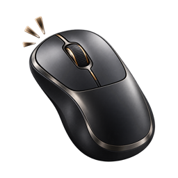
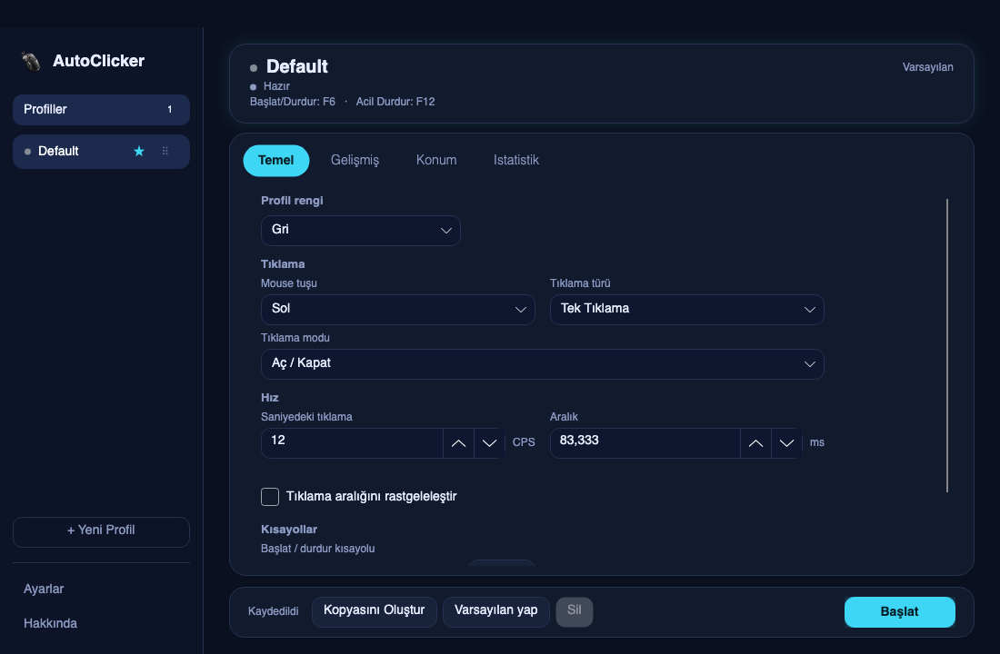
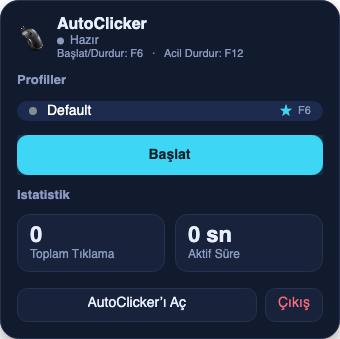

<div align="center">

**Türkçe** · [English](README.en.md)



# AutoClicker

**Sen bekle. O tıklasın.**
Profil profil ayarlanan, saniyede 500 tıklamaya kadar çıkan hafif otomatik tıklayıcı.

[](https://github.com/mertpural/auto-clicker/releases/latest)


[](LICENSE)

[**⬇️ İndir (macOS)**](https://github.com/mertpural/auto-clicker/releases/latest/download/AutoClicker-1.0.0-macOS-arm64.dmg) · [**⬇️ İndir (Windows)**](https://github.com/mertpural/auto-clicker/releases/latest/download/AutoClicker-1.0.0-win-x64-portable.zip) · [Web sitesi](https://autoclicker-tr.netlify.app) · [Sorun bildir](https://github.com/mertpural/auto-clicker/issues)

</div>

<p align="center">
  
  
  
</p>
<p align="center"><sub>Gece Neon, Sade Beyaz ve Oyun HUD. Toplam 5 yeni tema ve klasik renkler var, hepsi ayarlardan seçilir.</sub></p>

## Neler yapar?

| | |
|---|---|
| 👤 **Profiller** | Her oyun veya iş için ayrı ayar kaydet: hız, tuş, kısayol. Sürükleyerek sırala, birini varsayılan yap. Minecraft ve Roblox için hazır öneriler var. |
| ⚡ **500 CPS'e kadar hız** | Saniyede 0,001 ile 500 tıklama arası. Sabit ya da rastgele aralık, CPS ve ms birbirine bağlı çalışır. |
| 🖱️ **Tıklama türleri** | Sol, sağ, orta tuş. Tek veya çift tıklama. Aç/kapat ya da basılı tutma modu. |
| 📊 **İstatistik** | Toplam tıklama ve aktif süre tutulur, profil başına görürsün. |
| ⌨️ **Kısayollar** | Başlat/durdur (varsayılan F6) ve acil durdurma (F12). Uygulama arkadaysa da çalışır. |
| 🍎 **Menü çubuğu** | Mac'te üstteki simgeye basınca profiller, başlat/durdur ve istatistikler açılır. Pencereyi kapatsan da arkada çalışır. |
| 🎨 **Temalar** | Gece Neon, Sade Beyaz, Aurora Cam, Terminal, Oyun HUD ve klasik renkler. Türkçe ve İngilizce arayüz. |
| 🔒 **Gizli** | Hesap yok, sunucu yok, veri bilgisayarından çıkmaz. Ücretsiz ve reklamsız. |

<p align="center"></p>

## Kurulum

### Mac (macOS 11 veya üstü, Apple Silicon)

1. [DMG'yi indir](https://github.com/mertpural/auto-clicker/releases/latest/download/AutoClicker-1.0.0-macOS-arm64.dmg), aç ve `AutoClicker`'ı **Uygulamalar** klasörüne sürükle.
2. İlk açılışta **sağ tıkla → Aç → Aç** de (ticari sertifikası olmadığı için gerekir).
3. **Sistem Ayarları → Gizlilik ve Güvenlik** bölümünden **Erişilebilirlik** ve **Girdi İzleme** izinlerini ver. Eksik izin olursa uygulama ekranda söyler.

Terminalden tek satır:

```bash
curl -L https://github.com/mertpural/auto-clicker/releases/latest/download/AutoClicker-1.0.0-macOS-arm64.dmg -o /tmp/AutoClicker.dmg \
  && hdiutil attach -quiet /tmp/AutoClicker.dmg \
  && cp -R /Volumes/AutoClicker/AutoClicker.app /Applications/ \
  && hdiutil detach -quiet /Volumes/AutoClicker \
  && open /Applications/AutoClicker.app
```

### Windows (10 / 11, 64 bit)

[ZIP'i indir](https://github.com/mertpural/auto-clicker/releases/latest/download/AutoClicker-1.0.0-win-x64-portable.zip), bir klasöre çıkar ve **AutoClicker-Baslat.bat** dosyasına çift tıkla. Kurulum gerekmez. Windows SmartScreen uyarırsa *Ek bilgi → Yine de çalıştır* de.

### Kaynaktan derle

.NET 8 SDK gerekir.

```bash
git clone https://github.com/mertpural/auto-clicker.git
cd auto-clicker
dotnet run --project AutoClicker.csproj     # çalıştır
dotnet test AutoClicker.sln                 # testler
bash scripts/publish-macos.sh               # macOS DMG
```

## Notlar

- C#, .NET 8 ve [Avalonia](https://avaloniaui.net) ile yazıldı; macOS ve Windows aynı kodu kullanır.
- Windows sürümü Mac'te derlenip test edildi, gerçek bir Windows bilgisayarda henüz geniş çapta denenmedi. Sorun görürsen [bildir](https://github.com/mertpural/auto-clicker/issues).
- Gerçek hız işletim sistemi yüküne bağlı olarak hedeften sapabilir.
- Yapılacaklar için [ROADMAP.md](ROADMAP.md), değişiklikler için [CHANGELOG.md](CHANGELOG.md).

## Lisans

MIT
