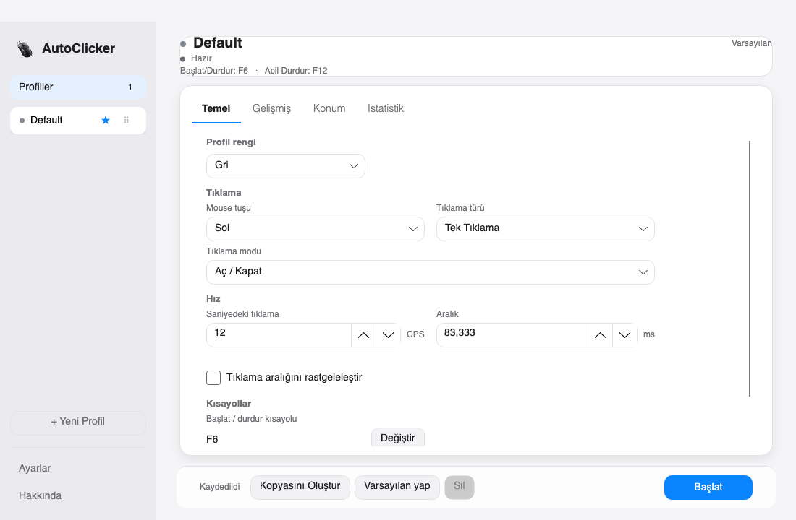
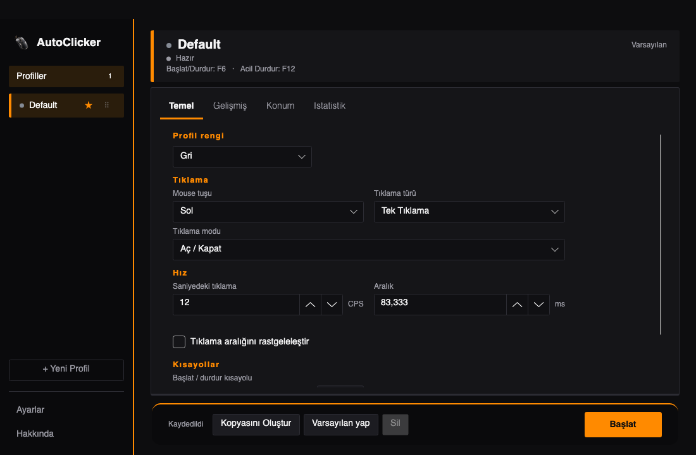
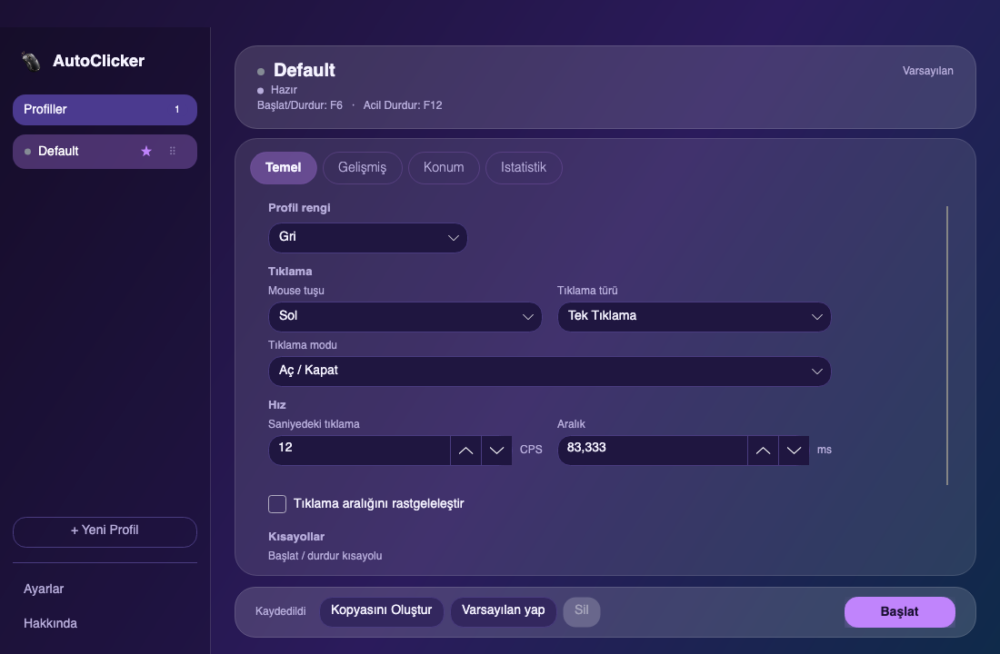

# AutoClicker

Hafif, reklamsız, ücretsiz otomatik tıklayıcı. Şimdilik **macOS** için hazır, Windows sürümü sonra gelecek.

**İndir:** https://autoclicker-tr.netlify.app

| Gece Neon | Sade Beyaz |
|---|---|
|  |  |
| **Oyun HUD** | **Aurora Cam** |
|  |  |

## Özellikler

- **Profiller:** Her oyun veya iş için ayrı ayar kaydedin (hız, tuş, kısayol). Sürükleyerek sıralayın, varsayılan seçin. Minecraft ve Roblox için hazır profil önerileri var.
- **Hız:** Saniyede 0,001 ile **500 tıklamaya (CPS)** kadar; sabit ya da rastgele aralık.
- **Tıklama türü:** Sol, sağ, orta tuş; tek veya çift tıklama; aç/kapat ya da basılı tutma.
- **İstatistik:** Toplam tıklama ve aktif süre tutulur.
- **Kısayollar:** Başlat/durdur ve acil durdurma tuşları (varsayılan F6 / F12).
- **Menü çubuğu:** Mac'te menü çubuğundaki simgeye basınca profiller, başlat/durdur ve istatistikler açılır. Pencereyi kapatsanız da arkada çalışır.
- **Temalar:** Gece Neon (varsayılan), Sade Beyaz, Aurora Cam, Terminal, Oyun HUD ve klasik renkler. Türkçe ve İngilizce.

## Kurulum (macOS)

Kolay yol: siteden DMG'yi indirin, `AutoClicker` uygulamasını Uygulamalar klasörüne sürükleyin. İlk açılışta sağ tıklayıp **Aç**'ı seçin.

Terminalden kaynak koddan kurmak için (.NET 8 SDK gerekir):

```bash
git clone https://github.com/mertpural/auto-clicker.git
cd auto-clicker
bash scripts/publish-macos.sh
open artifacts/release/macos
```

Doğrudan çalıştırmak için: `dotnet run --project AutoClicker.csproj`

**İzinler:** Sistem Ayarları → Gizlilik ve Güvenlik bölümünde **Erişilebilirlik** ve **Girdi İzleme** izinlerini verin. Uygulama eksik izni ekranda gösterir.

## Geliştirme

```bash
dotnet test AutoClicker.sln
```

Teknik notlar için [CHANGELOG.md](CHANGELOG.md) ve `docs/` klasörüne bakın.

## Lisans

[MIT](LICENSE)
